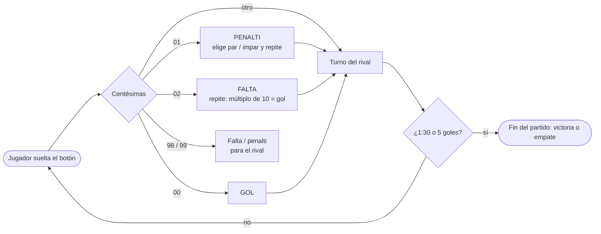

# El juego del cronómetro


Juego para **dos jugadores** sobre la placa **TI LaunchPad MSP-EXP430FR6989**: cada jugador intenta parar un cronómetro en la centésima exacta para marcar "goles". Programado en **C a nivel de registros** y sin bucle principal: el micro duerme en modo de bajo consumo (`LPM0`) y **todo el juego ocurre dentro de rutinas de interrupción** (botones, timers y UART).

> Práctica final de **Estructura de Computadores**

---

## Cómo se juega

Los jugadores se turnan y, en cada turno, el jugador **mantiene pulsado** su botón para que corra el cronómetro y lo **suelta** para pararlo. Lo que cuenta son las **centésimas** en que se para:

| Centésimas | Jugada                          | Resultado                                                                                                            |
| :---------: | ------------------------------- | -------------------------------------------------------------------------------------------------------------------- |
|   `00`   | **Gol**                   | +1 gol para el jugador                                                                                               |
|   `01`   | **Penalti**               | Elige **par** (`P`) o **impar** (`I`) por la terminal y vuelve a tirar. Si acierta la paridad → gol |
|   `02`   | **Falta**                 | Vuelve a tirar. Si para en un múltiplo de 10 (`00`, `10`, `20`…) → gol                                      |
|   `99`   | Penalti para el **rival** |                                                                                                                      |
|   `98`   | Falta para el **rival**   |                                                                                                                      |
|    otro    | —                              | Pasa el turno                                                                                                        |

El partido termina al llegar a **1:30** en el cronómetro o cuando alguien marca **5 goles**. 

Al pulsar cualquier otra tecla en la terminal se consulta el marcador.



---

## Hardware

| Elemento         | Recurso del MSP430                                    | Uso                                                                                                      |
| ---------------- | ----------------------------------------------------- | -------------------------------------------------------------------------------------------------------- |
| Botón S1 / S2   | `P1.1` / `P1.2`                                   | Jugador 1/ Jugador 2 (interrupción por flanco, alternando bajada/ subida para detectar pulsar y soltar) |
| LED rojo / verde | `P1.0` / `P9.7`                                   | Indican de quién es el turno                                                                            |
| LCD segmentado   | Controlador `LCD_C` (4-MUX)                         | Cronómetro `M:SS:CC` + animaciones de gol, penalti, falta y cambio de turno                           |
| Cronómetro      | `Timer1_A` (ACLK 32 768 Hz, CCR0 = 327)             | Interrupción cada ~10 ms → centésimas                                                                 |
| Animaciones      | `Timer0_A` (SMCLK, comparación CCR0 + overflow)    | Parpadeo y desplazamiento de segmentos                                                                   |
| Terminal serie   | `eUSCI_A1` en `P3.4`/`P3.5` (9600 baudios, 8N1) | Mensajes del partido y elección par/ impar por interrupciones RX/TX                                     |
| Reloj            | DCO a 8 MHz (MCLK/SMCLK), LFXT para ACLK              |                                                                                                          |

---

## Arquitectura

```
main()  →  init pines / reloj / timers / LCD / UART  →  LPM0 + GIE (duerme)
                                                             │
     ┌──────────────────┬───────────────────┬────────────────┴──────────┐
 PORT1_VECTOR      TIMER1_A0_VECTOR    TIMER0_A0/A1_VECTOR       USCI_A1_VECTOR
 botones:          +1 centésima,       paso de animación         RX: tecla P/I o marcador
 arranca/para      refresca LCD        en el LCD                 TX: envía el mensaje
 y evalúa jugada                                                 carácter a carácter
```

- **Máquina de estados** del partido (`NORMAL`, `PENALTI`, `FALTA`) y de animaciones (`tAnimacion`).
- **Transmisión UART no bloqueante**: el mensaje se copia a un buffer y la ISR de TX lo envía byte a byte.
- **Sin librerías de alto nivel**: acceso directo a registros (`P1IE`, `TA1CCTL0`, `LCDMx`, `UCA1TXBUF`…).

---

## Descargar

¿No quieres compilar? Descarga el firmware ya compilado desde la [última release](https://github.com/xilin01/EC-Juego-del-Cronometro/releases/latest):

| Archivo | Para qué |
| --- | --- |
| `juego-cronometro.txt` | Firmware en formato TI-TXT. Se flashea con [UniFlash](https://www.ti.com/tool/UNIFLASH) |
| `juego-cronometro.out` | Ejecutable ELF para Code Composer Studio o UniFlash (sirve también para depurar) |

1. Conecta la LaunchPad por USB y abre UniFlash. Detecta sola la **MSP430FR6989**.
2. Carga `juego-cronometro.txt` y pulsa **Load Image**.
3. Abre una terminal serie en el puerto *"MSP Application UART1"* a **9600 baudios, 8N1**.

---

## Compilar y ejecutar

1. Instala [Code Composer Studio](https://www.ti.com/tool/CCSTUDIO) (versión basada en Theia).
2. `File → Import Projects` y selecciona la carpeta [`PR5/`](PR5).
3. Conecta la LaunchPad MSP-EXP430FR6989 por USB, compila y pulsa **Debug/Flash**.
4. Abre una terminal serie (PuTTY, terminal de CCS…) en el puerto *"MSP Application UART1"* a **9600 baudios, 8N1**.
5. Empieza el **Jugador 1** (LED rojo): ¡a jugar!

---

## Estructura

```
.
├── PR5/
│   ├── main.c                  # Todo el juego (≈420 líneas)
│   ├── driverlib/              # MSP430 DriverLib de TI
│   ├── lnk_msp430fr6989.cmd    # Script del enlazador
│   └── targetConfigs/          # Configuración del depurador
└── docs/
    └── enunciado.docx          # Enunciado de la práctica
```

---

## Licencia

Código propio bajo licencia [MIT](LICENSE). La carpeta `PR5/driverlib/` es de Texas Instruments (BSD-3-Clause).
